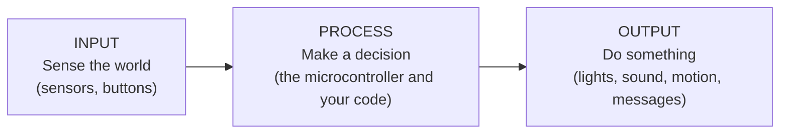
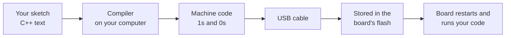
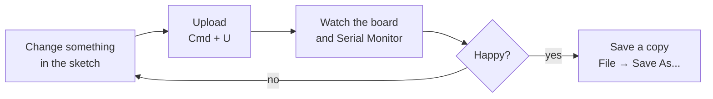
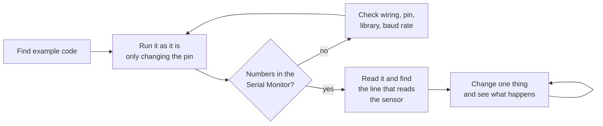
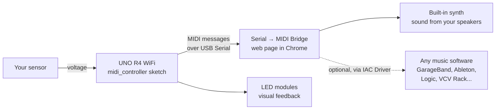

# Introduction to Microcontrollers

A 90 to 120 minute workshop where students program an Arduino UNO R4 WiFi, plug in sensors and lights from the DFRobot Gravity sensor kit, and turn what they build into a MIDI controller that plays music on a computer.

By the end of the session you'll have built your own interactive system: a sensor of your choosing that controls lights, and then a synth.

The learning objectives are:
- Understanding what a microcontroller is, and where it sits in the history of computing.
- Breaking interactive things down into **systems** of inputs, processes and outputs.
- Researching, running and changing code you find online.
- Connecting a microcontroller to other systems, like music software, through protocols like MIDI.

**You do not need any programming or electronics experience, this workshop is designed for complete beginners.** Every step is written out below. If something goes wrong (and it will) check the troubleshooting tables and then shout for help.

## Contents

- [Introduction to Microcontrollers](#introduction-to-microcontrollers)
  - [Contents](#contents)
  - [What's on your desk](#whats-on-your-desk)
  - [What's in this folder](#whats-in-this-folder)
  - [Timings](#timings)
  - [Section 1: What is a Microcontroller?](#section-1-what-is-a-microcontroller)
    - [Part 1.1: Computers you never see](#part-11-computers-you-never-see)
    - [Part 1.2: How small is small?](#part-12-how-small-is-small)
    - [Part 1.3: A short history](#part-13-a-short-history)
    - [Part 1.4: Thinking in systems](#part-14-thinking-in-systems)
    - [Part 1.5: A tour of the UNO R4 WiFi](#part-15-a-tour-of-the-uno-r4-wifi)
  - [Section 2: Hello, World! (Blink)](#section-2-hello-world-blink)
    - [Part 2.1: The Arduino IDE](#part-21-the-arduino-ide)
    - [Part 2.2: The Arduino language](#part-22-the-arduino-language)
    - [Part 2.3: Wire up an LED](#part-23-wire-up-an-led)
    - [Part 2.4: Upload Blink](#part-24-upload-blink)
      - [The loop you'll use for the rest of the workshop](#the-loop-youll-use-for-the-rest-of-the-workshop)
    - [Part 2.5: Make it yours](#part-25-make-it-yours)
      - [Troubleshooting](#troubleshooting)
  - [Section 3: Sensors](#section-3-sensors)
    - [Part 3.1: Analogue and digital](#part-31-analogue-and-digital)
    - [Part 3.2: How sensors talk: protocols](#part-32-how-sensors-talk-protocols)
    - [Part 3.3: Libraries](#part-33-libraries)
    - [Part 3.4: Pick a sensor](#part-34-pick-a-sensor)
    - [Part 3.5: Find the code](#part-35-find-the-code)
      - [Where to look](#where-to-look)
      - [What to look for](#what-to-look-for)
      - [How to approach it](#how-to-approach-it)
      - [Wiring your sensor](#wiring-your-sensor)
    - [Part 3.6: Sensor to LEDs](#part-36-sensor-to-leds)
      - [Step 1: Paste in your sensor code](#step-1-paste-in-your-sensor-code)
      - [Step 2: Find your sensor's range](#step-2-find-your-sensors-range)
      - [Step 3: Choose what the LEDs do](#step-3-choose-what-the-leds-do)
      - [Better outputs](#better-outputs)
      - [Troubleshooting](#troubleshooting-1)
  - [Section 4: Make a MIDI Controller](#section-4-make-a-midi-controller)
    - [Part 4.1: Outputs can be other systems](#part-41-outputs-can-be-other-systems)
    - [Part 4.2: MIDI in two minutes](#part-42-midi-in-two-minutes)
    - [Part 4.3: Our system](#part-43-our-system)
    - [Part 4.4: Play it](#part-44-play-it)
      - [Step 1: Upload the MIDI controller sketch](#step-1-upload-the-midi-controller-sketch)
      - [Step 2: Open the bridge](#step-2-open-the-bridge)
      - [Step 3: Make it yours](#step-3-make-it-yours)
      - [Troubleshooting](#troubleshooting-2)
    - [Part 4.5: Play it in other software (optional)](#part-45-play-it-in-other-software-optional)
    - [Part 4.6: Extension: be a USB keyboard](#part-46-extension-be-a-usb-keyboard)
  - [Section 5: Further Reading and References](#section-5-further-reading-and-references)
    - [Documentation used in this workshop](#documentation-used-in-this-workshop)
    - [Where to go from here](#where-to-go-from-here)
  - [Glossary](#glossary)

> [!WARNING]
> **Jargon ahead!** Electronics and programming come with a lot of jargon and acronyms. Don't worry if a word goes over your head, you don't need to remember them all. Whenever you get stuck on one, check the [Glossary](#glossary) at the bottom, ask the internet or ask a technician.

## What's on your desk

- An **Arduino UNO R4 WiFi**.
- A **USB-C cable**.
- Two **Gravity LED modules** (small boards with a single LED on them).
- A **DFRobot Gravity sensor kit** (shared between the table), full of sensors and other modules.
- Some **Gravity cables** (3 wires ending in a black plug) and **jumper wires** (single wires with a pin on each end).
- A computer with the **Arduino IDE**, **Google Chrome** and this folder (`Intro-to-Microcontrollers`) already on it.

> **[FIGURE 0.1 — placeholder]** Photo of the workshop kit laid out on a desk: UNO R4 WiFi, USB-C cable, two LED modules, Gravity cables, jumper wires, and the open sensor kit box.

## What's in this folder

| Folder / file | What it is |
| --- | --- |
| [README.md](README.md) | This document, the workshop itself. |
| [SENSORS.md](SENSORS.md) | A cheat sheet for every module in the kit: what it senses, how it talks, which library it needs and where to find its documentation. |
| [examples/blink](examples/blink/blink.ino) | Section 2: blink an LED. |
| [examples/sensor_to_leds](examples/sensor_to_leds/sensor_to_leds.ino) | Section 3: a template for making LEDs react to any sensor. **This is the file you'll be changing the most.** |
| [examples/midi_controller](examples/midi_controller/midi_controller.ino) | Section 4: turns your sensor into a MIDI controller. |
| [examples/keyboard_controller](examples/keyboard_controller/keyboard_controller.ino) | Section 4 extension: turns your sensor into a USB keyboard. |
| [midi-bridge](midi-bridge/index.html) | A web page that turns messages from the Arduino into sound, or sends them on to music software. |
| [workshop_setup](workshop_setup) | For technicians only: [how to prepare the workshop computers and kits](workshop_setup/README.md). |

## Timings

| Section | Roughly |
| --- | --- |
| 1. What is a Microcontroller? | 20 min |
| 2. Hello, World! (Blink) | 20 min |
| 3. Sensors | 35 min |
| 4. Make a MIDI Controller | 25 min |
| Wrap up, show and tell | 5 to 20 min |

---

## Section 1: What is a Microcontroller?

### Part 1.1: Computers you never see

When you think of a computer you probably picture a laptop, a phone or a games console: something with a screen, a keyboard or touchscreen, an operating system and lots of apps.

But most of the computers in the world don't look like that at all. They are hidden inside other things, each doing one job, over and over, for years without anyone noticing:

- The microwave that counts down and beeps.
- The washing machine that fills, spins and drains.
- The remote control, the TV, the electric toothbrush, the smart light bulb.
- Your car, which might have more than 100 of them: one for the windows, one for the airbags, one for the engine...
- The MIDI keyboard, game controller and mouse plugged into your computer.

These hidden computers are **microcontrollers**: a whole small computer (a processor, memory, storage and connections to the outside world) squeezed onto **one single chip**. Around 30 billion of them are made every year, several for every person on the planet. They are used when a full computer with an operating system would be overkill: too expensive, too power hungry, too slow to start and too complicated for the job.

Computers like the one you are using right now are built differently. Their processor (a **microprocessor**) is just the "thinking" part. It needs separate chips for memory, storage, graphics and everything else, plus an operating system to manage it all.

| | Microprocessor | Microcontroller | Single-board computer |
| --- | --- | --- | --- |
| **Example** | The Apple M-series or Intel Core chip in a laptop | The Renesas RA4M1 on our Arduino | Raspberry Pi |
| **What's on the chip** | Just the processor. Memory, storage etc. are separate chips | Processor, memory, storage and input/output pins, all on one chip | A microprocessor and everything it needs on one small board |
| **Operating system** | Yes: macOS, Windows, Linux | No. Just your program, running directly on the chip | Yes, usually Linux |
| **Starts up in** | 10s of seconds | A fraction of a second | 10s of seconds |
| **Good at** | Doing lots of complicated things at once | Doing one job reliably, at exactly the right moment, talking directly to electronics | A small, cheap, full computer |
| **Power** | 10s to 100s of watts | Thousandths of a watt (milliwatts) | A few watts |

### Part 1.2: How small is small?

Just how much less powerful is a microcontroller than a modern computer?

| | Laptop (e.g. MacBook Air) | Arduino UNO R4 WiFi (Renesas RA4M1) |
| --- | --- | --- |
| **Processor** | 8 to 10 cores at up to ~4 GHz | 1 core at 48 **MHz** |
| **Memory (RAM)** | 16 to 32 GB | 32 **KB** |
| **Storage** | 256 GB to 2 TB of SSD | 256 **KB** of flash |
| **Operating system** | macOS | None, it runs your code directly |
| **Graphics** | A built-in GPU driving millions of pixels | None (but it does have 96 little red LEDs) |
| **Starts up in** | ~20 seconds | Instantly |
| **Power** | ~30 W | Under 1 W for the whole board |
| **Cost** | £1,000+ | ~£25 |

That's around **half a million times less memory**. A single photo on your phone wouldn't fit in it. And yet, as you'll see, it's plenty to read a sensor, make decisions and talk to other devices hundreds of times a second.

It helps to compare it with some other famous computers too:

| Computer | Year | Speed | Memory (RAM) | What it did |
| --- | --- | --- | --- | --- |
| [Apollo Guidance Computer](https://en.wikipedia.org/wiki/Apollo_Guidance_Computer) | 1966 | ~1 MHz | 4 KB | Flew astronauts to the Moon |
| Original Arduino UNO (ATmega328P) | 2010 | 16 MHz | 2 KB | Taught millions of people electronics |
| **Arduino UNO R4 WiFi (RA4M1)** | **2023** | **48 MHz** | **32 KB** | **What we're using today** |
| [Interstate 75W (RP2350)](https://github.com/ctlnorwich/Intro-to-LED-Signage) | 2020s | 2 × 150 MHz | 520 KB | Drives the LED signs in our [LED Signage workshop](https://github.com/ctlnorwich/Intro-to-LED-Signage) |
| Laptop | Today | 10 × ~4 GHz | 16,000,000 KB | Everything else |

Our little board has eight times the memory of the computer that landed on the Moon.

### Part 1.3: A short history

Microcontrollers grew up alongside the computers we're more familiar with. Here are some of the big moments:

| Year | What happened |
| --- | --- |
| **1945** | [ENIAC](https://en.wikipedia.org/wiki/ENIAC), one of the first general purpose electronic computers, fills a room and weighs 27 tonnes. |
| **1966** | The [Apollo Guidance Computer](https://en.wikipedia.org/wiki/Apollo_Guidance_Computer) is one of the first computers built from integrated circuits (chips), and one of the first *embedded* computers: built into a spacecraft to do one job. |
| **1971** | Intel's [4004](https://en.wikipedia.org/wiki/Intel_4004), the first commercial **microprocessor**, puts a whole processor onto one chip. It was made for a calculator. |
| **1971 to 1974** | At Texas Instruments, Gary Boone and Michael Cochran create the [TMS1000](https://en.wikipedia.org/wiki/Texas_Instruments_TMS1000), usually called the first **microcontroller**: processor, memory and inputs/outputs on a single chip. It ends up in calculators, toys, microwaves and more. |
| **1977** | The Apple II, Commodore PET and TRS-80 bring personal computers into homes. |
| **1980** | Intel's [8051](https://en.wikipedia.org/wiki/Intel_8051) microcontroller. Copies of it are still being made today, over 40 years later. |
| **1983** | The [MIDI](https://en.wikipedia.org/wiki/MIDI) standard lets synthesisers from different companies talk to each other (more on this in [Section 4](#section-4-make-a-midi-controller)). Inside every one of them is a microcontroller. |
| **1996** | Two students in Norway, Alf-Egil Bogen and Vegard Wollan, design the [AVR](https://en.wikipedia.org/wiki/AVR_microcontrollers) microcontroller, later the brain of the original Arduino. |
| **2001 to 2003** | [Processing](https://processing.org/) makes coding accessible to artists and designers, and [Wiring](https://wiring.org.co/) (Hernando Barragán) does the same for electronics. |
| **2004** | Dan O'Sullivan and Tom Igoe publish *Physical Computing*, the book that named the field this workshop is about. |
| **2005** | [Arduino](https://www.arduino.cc/en/about) is born at the Interaction Design Institute Ivrea in Italy, a cheap, open source board so that design students could make interactive things without being electronics engineers. |
| **2012 to 2021** | The Raspberry Pi (2012) and Raspberry Pi Pico microcontroller (2021) make tiny computers even cheaper. |
| **2023** | The [Arduino UNO R4](https://docs.arduino.cc/hardware/uno-r4-wifi/) arrives: same shape as the original UNO, with a much more powerful 32-bit chip, Wi-Fi and Bluetooth. |

Arduino was designed for people *exactly like you*: artists and designers who wanted to make things that sense and respond to the world, without a degree in electrical engineering.

> **[FIGURE 1.1 — placeholder]** A row of photos, left to right: ENIAC filling a room, the Apollo Guidance Computer, the Intel 4004 chip, the original Arduino, and the UNO R4 WiFi, to show how computers have shrunk.

### Part 1.4: Thinking in systems

**Physical computing** means making computers that sense and respond to the physical world, rather than just to a keyboard and a mouse. The most useful idea in physical computing is that every interactive thing is a **system** made up of three parts:



Take an automatic door at a supermarket:

| | Automatic door |
| --- | --- |
| **Input** | A motion sensor above the door notices someone walking towards it. |
| **Process** | A microcontroller decides: *"Someone is there, and the door is closed, so open it. Then wait five seconds after they've gone, and close it."* |
| **Output** | A motor slides the doors open and closed. |

Big systems are made of smaller systems, and the output of one system is often the input of another. The automatic door might also send a message to a computer counting how many customers came in today. That computer is a whole other system, with the door as its input.

Breaking things down like this is how you design anything interactive. When something you've built doesn't work, it's also the best way to find out why: *is the problem in the input, the process or the output?*

**Try it (2 minutes):** pick something near you that reacts to the world (a phone, a toaster, a bike light, a games controller...) and break it into inputs, processes and outputs. What happens if you swap the output for something else?

### Part 1.5: A tour of the UNO R4 WiFi

> **[FIGURE 1.2 — placeholder]** Photo of the UNO R4 WiFi from above, labelling: the RA4M1 chip, the ESP32-S3 module, the USB-C port, the digital pins (0 to 13), the analogue pins (A0 to A5), the power pins (5V, 3.3V, GND), the LED matrix, the RESET button, the "L" LED and the Qwiic connector.

| Part | What it does |
| --- | --- |
| **Renesas RA4M1** | The main microcontroller. This is where your code runs. |
| **ESP32-S3** | A *second* microcontroller that handles Wi-Fi and Bluetooth, and passes messages between the USB port and the RA4M1. |
| **USB-C port** | Powers the board, uploads your code and lets the board send messages to the computer. |
| **Digital pins (0 to 13)** | Can be switched on and off (outputs) or can tell whether something is on or off (inputs). The ones marked with a **~** can also "dim" things (more on that in [Part 3.1](#part-31-analogue-and-digital)). |
| **Analogue pins (A0 to A5)** | Can measure a voltage, so they can read sensors that give more than just on or off. |
| **Power pins** | **5V** and **3.3V** supply power to modules. **GND** (ground) is 0 volts, the "return path" that completes every circuit. |
| **12 × 8 LED matrix** | 96 red LEDs you can draw on. |
| **"L" LED** | A tiny LED wired to pin 13. |
| **RESET button** | Restarts your code from the beginning. |
| **Qwiic connector** | A plug for some I2C sensors (see [Part 3.2](#part-32-how-sensors-talk-protocols)). |

---

## Section 2: Hello, World! (Blink)

When people learn a new programming language, the first program they traditionally write just prints *"Hello, World!"*. In physical computing, the equivalent is making an LED blink. It's simple, but it proves that every part of the system works: the computer, the cable, the board, your code and the wiring.

### Part 2.1: The Arduino IDE

We write code for the Arduino in the **Arduino IDE** (Integrated Development Environment): a text editor with buttons to turn your code into something the board can run, and send it over.

1. Open **Arduino IDE** (press <kbd>Cmd</kbd> + <kbd>Space</kbd>, type **Arduino IDE**, press <kbd>Enter</kbd>).
2. Plug the UNO R4 WiFi into the computer with the USB-C cable. The LED matrix might start showing whatever it was last programmed to do. That's fine!
3. At the top of the window there is a drop down menu that says **Select Board**. Click it and pick **Arduino UNO R4 WiFi**. If you can see more than one, pick the one that mentions a port with `usbmodem` in the name.

> **[FIGURE 2.1 — placeholder]** Screenshot of the Arduino IDE with each part labelled: Verify (tick), Upload (arrow), the board selector, the Serial Monitor and Serial Plotter buttons (top right), the sketch editor, and the Output panel at the bottom.

| Button | Name | What it does |
| --- | --- | --- |
| ✓ | **Verify** | Checks your code for mistakes and turns it into machine code (this is called **compiling**). |
| → | **Upload** | Verifies, then sends the result to the board, which starts running it straight away. |
| 〜 (top right) | **Serial Plotter** | Draws a live graph of numbers the board sends to the computer. |
| 🔍 (top right) | **Serial Monitor** | Shows text the board sends to the computer, and lets you send text back. |

Arduino programs are called **sketches** (a name inherited from [Processing](https://processing.org/), because they're meant to be quick, rough and experimental like a sketch on paper).

### Part 2.2: The Arduino language

Arduino sketches are written in **C++**, a programming language from the 1980s that is still used for games, operating systems and pretty much anything where speed matters. Arduino adds a set of ready-made commands on top (`digitalWrite`, `analogRead`, `delay`...) that hide the complicated bits, so you can say *"switch pin 3 on"* without needing to know which part of the chip's memory controls pin 3.

When you press **Upload**, this happens:



The **compiler** translates your C++ into the 1s and 0s the chip understands *before* it gets sent to the board. (If you've done our [LED Signage workshop](https://github.com/ctlnorwich/Intro-to-LED-Signage), MicroPython works differently: the code is sent as text and translated on the board as it runs.) Because your sketch is saved in the board's flash memory, it carries on working even after you unplug it from the computer. Plug it into any USB power supply and it starts running again.

Every Arduino sketch has two main parts:

```cpp
void setup() {
  // Runs ONCE when the board starts up.
  // Used to get things ready.
}

void loop() {
  // Runs over and over again, forever.
  // This is where the action happens.
}
```

`loop()` running forever is the heart of every microcontroller program. There's no "quitting" and no desktop to go back to. The board reads its inputs, decides what to do, updates its outputs, and goes round again, thousands of times a second, until the power is switched off.

Some rules of the language:

| Rule | Example |
| --- | --- |
| Every instruction ends with a **semicolon**. Forgetting one is the most common mistake there is. | `delay(500);` |
| Blocks of code that belong together go inside **curly brackets** `{ }`. | `void loop() { ... }` |
| **Comments** are notes for humans that the board ignores. One line starts with `//`. Several lines go between `/*` and `*/`. | `// wait half a second` |
| Capital letters matter. `digitalWrite` works, `DigitalWrite` doesn't. | |
| A **variable** is a named box for a value. You say what *type* of value it holds. `const` means it never changes. | `const int LED_PIN = 3;` |
| A **function** is a named, reusable chunk of code. You *call* it with brackets, putting any information it needs inside them. | `digitalWrite(LED_PIN, HIGH);` |

And the handful of built-in functions you'll use most:

| Function | What it does |
| --- | --- |
| `pinMode(pin, OUTPUT)` | Sets a pin up as an output (or `INPUT`). |
| `digitalWrite(pin, HIGH)` | Switches a pin on (5 volts). `LOW` switches it off (0 volts). |
| `digitalRead(pin)` | Reads a pin: gives `HIGH` (1) or `LOW` (0). |
| `analogRead(pin)` | Measures the voltage on an analogue pin: gives a number from 0 to 1023. |
| `analogWrite(pin, value)` | "Dims" a **~** pin: 0 is off, 255 is fully on. |
| `delay(ms)` | Waits for a number of milliseconds (1000 ms = 1 second). |
| `Serial.println(value)` | Sends a message to the computer, shown in the Serial Monitor. |
| `map(value, fromLow, fromHigh, toLow, toHigh)` | Rescales a number from one range to another. |

The full list is in the [Arduino language reference](https://docs.arduino.cc/language-reference/).

### Part 2.3: Wire up an LED

> [!NOTE]
> **Why use an LED module instead of a plain LED?** Each pin on the UNO R4 can only safely supply about **8 milliamps** (mA) of current, less than half of what the original UNO could. A plain LED plugged straight into a pin will try to draw more than that, which can damage the pin.
>
> The Gravity LED module solves this with a **transistor**: an electronic switch. The LED gets its power from the board's **5V** pin, and the signal pin just flicks the switch, which takes less than 1 mA. This is one of the most important ideas in physical computing: **a microcontroller's pins *control* things, they don't *power* them.** Motors, speakers and bright lights all work the same way.

Every Gravity module has three connections:

| Wire on the Gravity cable | Label on the module | What it's for | Goes to on the Arduino |
| --- | --- | --- | --- |
| **Green** | Signal | Carries the message: on or off | **Pin 3** |
| **Red** | **+** | Power | **5V** |
| **Black** | **−** | Ground, completing the circuit | **GND** (either of the two next to 5V) |

1. **Unplug the USB cable** while you're wiring. It's a good habit: it stops anything getting accidentally connected while it's live.
2. Plug a Gravity cable into one of your LED modules. It only fits one way round.
3. Push a jumper wire into each of the three holes in the black plug on the other end of the cable.
4. Push the other ends of the jumper wires into the Arduino, following the table. The pin names are printed next to the headers on the board.
5. Plug the USB cable back in.

> **[FIGURE 2.2 — placeholder]** Photo and simple diagram of the LED module wired to the UNO R4: green to pin 3, red to 5V, black to GND, with each pin's label on the board circled.

### Part 2.4: Upload Blink

1. In the Arduino IDE, go to **File → Open...** and open [examples/blink/blink.ino](examples/blink/blink.ino) from this folder.
2. Read through it. Every line has a comment explaining what it does.
3. Click **Upload** (→). The Output panel at the bottom will show a lot of text while it compiles and uploads, finishing with something like `Done!` or `Upload complete`.
4. Look at the LED module. It should be blinking: on for half a second, off for half a second.
5. Click the **Serial Monitor** button (top right). Make sure the speed in its bottom-right corner is set to **115200 baud**. You should see `on`, `off`, `on`, `off`... scrolling past. That's the board talking back to the computer.

> **[FIGURE 2.3 — placeholder]** Photo of the LED module lit up, wired to the UNO R4, next to a screenshot of the Serial Monitor showing "on" and "off".

You've just made a system! The input is time passing, the process is your code deciding when to switch, and the output is the light (and the messages to the computer).

#### The loop you'll use for the rest of the workshop



> [!TIP]
> The example sketches open as read-only "examples" in some versions of the IDE. When you want to keep your changes, use **File → Save As...** and save your own copy somewhere like your Desktop or Documents.

### Part 2.5: Make it yours

Try each of these, uploading after every change:

1. Change `ON_TIME` and `OFF_TIME` ([lines 21–22](examples/blink/blink.ino#L21-L22)) to make it blink faster or slower. How fast can it go before your eyes can't see the blinking any more?
2. Make it flash a heartbeat: two quick flashes, then a pause. (Hint: you'll need more `digitalWrite`s and `delay`s inside `loop()`.)
3. **Challenge:** flash `SOS` in Morse code: three short, three long, three short.
4. **Challenge:** wire up your second LED module to pin 5 (see [Part 3.6](#part-36-sensor-to-leds) for the wiring) and make the two LEDs take turns, like a railway crossing.

#### Troubleshooting

When something goes wrong, the Output panel at the bottom of the IDE shows an error in orange or red. Scroll up to find the **first** error; it's usually the useful one.

| You see | What it means | Fix |
| --- | --- | --- |
| `expected ';' before ...` | A missing semicolon. | Look at the line *above* the one in the error. |
| `'digitalwrite' was not declared in this scope` | A typo, or wrong capital letters. | Check the spelling against the examples. Capital letters matter. |
| `No device found on ...` / `Port not selected` | The IDE can't find the board. | Check the cable is plugged in, then pick the board again from the **Select Board** menu. Try a different USB port or cable (some cables only carry power, not data). |
| Upload worked but the LED doesn't light | Wiring, or the wrong pin. | Check the signal wire is in pin **3**, and that power and ground are in **5V** and **GND**. Try turning the LED module's cable round: is it plugged into the module the right way? |
| The Serial Monitor shows gibberish like `⸮⸮⸮` | The speeds don't match. | Set the Serial Monitor to **115200 baud**, to match `Serial.begin(115200)`. |

---

## Section 3: Sensors

So far our system's only input is time. Now let's give it senses.

The DFRobot kit is full of modules. Some are **sensors** (inputs) that measure something about the world: light, sound, temperature, touch, tilt, distance, colour, even your heart rate. Others are **actuators** (outputs) that do something: LEDs, a speaker, motors, a display.

Before you choose one, it helps to know how sensors talk to a microcontroller.

### Part 3.1: Analogue and digital

Microcontrollers only really understand voltages, and there are two ways a sensor can use a voltage to tell you something.

| | **Digital** | **Analogue** |
| --- | --- | --- |
| **What it means** | Only two possible values: on or off. | Any value in a range. |
| **Like a...** | Light switch | Dimmer switch or volume knob |
| **Voltages** | 0 V (`LOW`) or 5 V (`HIGH`) | Anywhere between 0 V and 5 V |
| **How to read it** | `digitalRead(pin)` gives `0` or `1` | `analogRead(pin)` gives `0` to `1023` |
| **Which pins** | Any pin | **A0 to A5** only |
| **Kit examples** | Push buttons, touch, tilt, magnet, motion (PIR), shake | Light, rotation knob, sound, flame, temperature, soil moisture |

**Reading analogue: the ADC.** The analogue pins are connected to an **analogue-to-digital converter** (ADC): a part of the chip that measures a voltage and turns it into a number. By default the UNO R4 splits 0 to 5 volts into 1024 steps, so 0 V reads as `0`, 5 V reads as `1023`, and 2.5 V reads as about `512`. (The R4's ADC can actually do up to 16,384 steps; look up `analogReadResolution()` if you're curious.)

> **[FIGURE 3.1 — placeholder]** Two graphs side by side over time: a digital signal jumping between 0 and 1, and an analogue signal smoothly rising and falling between 0 and 1023, with the light sensor reading as the example.

**Writing "analogue": PWM.** Most of the pins can only *output* fully on or fully off. So how does `analogWrite()` dim an LED? It cheats. It switches the pin on and off hundreds of times a second, far too fast for your eyes to see. If the pin is on half of the time, the LED looks half as bright. This trick is called **PWM** (Pulse Width Modulation) and only works on the pins marked **~** (3, 5, 6, 9, 10 and 11).

> **[FIGURE 3.2 — placeholder]** Three PWM waveforms: 10% on (dim), 50% on (medium) and 90% on (bright), each next to an LED drawn at that brightness.

### Part 3.2: How sensors talk: protocols

Simple sensors just set a voltage on a wire. More complicated ones (a colour sensor that measures red, green *and* blue, or an accelerometer that measures movement in three directions) have their own tiny chip on board, and need to send lots of numbers. To do that, the sensor and the microcontroller need to agree on a **protocol**: a set of rules for how to send information over wires, just like two people need to agree on a language.

| Protocol | Wires | How it works | Used for | In our kit |
| --- | --- | --- | --- | --- |
| **Digital** | 1 signal | On or off. | Buttons, switches, simple detectors | Buttons, touch, tilt, magnet, PIR, shake, vibration |
| **Analogue** | 1 signal | A voltage that represents an amount. | Simple sensors | Light, sound, rotation, flame, temperature, ultrasonic distance, joystick |
| **I2C** (*"eye-squared-see"*) | 2: data (**SDA**) and clock (**SCL**) | Each device has an *address*. The microcontroller calls out an address, and only that device answers. Lots of devices can share the same two wires. | Smart sensors, small displays | Colour sensor, accelerometer, wattmeter, LCD display |
| **UART Serial** | 2: transmit (**TX**) and receive (**RX**) | Two devices take turns sending bytes to each other at an agreed speed (the **baud rate**). | GPS modules, Bluetooth modules, and talking to the computer over USB | The Arduino to your computer (`Serial.println`) |
| **SPI** | 4 | Like I2C but much faster, with an extra wire to pick which device you're talking to. | Big displays, SD cards | Not in this kit |
| **One-wire / custom** | 1 | Some devices invent their own protocol using careful timing on one wire. | Addressable RGB LEDs (NeoPixels), some temperature sensors | The RGB LED module |

You don't need to understand how these protocols work in detail. That's what libraries are for.

### Part 3.3: Libraries

A **library** is a bundle of code someone else has written so that you don't have to. Instead of learning exactly which bytes to send to a colour sensor's chip over I2C, you install a library and write something like `colourSensor.getRed()`.

- Libraries are installed from the **Library Manager**: the 📚 icon on the left of the IDE, or **Tools → Manage Libraries...**.
- You add a library to your sketch with an `#include` line at the very top, like `#include <DFRobot_TCS34725.h>`.
- Almost every library comes with example sketches. After installing one, look in **File → Examples**, scroll down to the library's name, and you'll find ready-to-run code. **This is often the fastest way to get a sensor working.**
- Most digital and analogue sensors don't need a library at all: `digitalRead()` and `analogRead()` are enough.

Libraries are a perfect example of the open source culture that Arduino grew out of. Thousands of people have written code for every sensor imaginable and shared it for free. When you use someone's code, it's good practice to leave a comment saying where it came from.

### Part 3.4: Pick a sensor

Now for the fun part. Open the sensor kit and choose **one sensor** that interests you. Each one is labelled with its name and a code starting with **DFR** or **SEN**, called the **SKU**. You'll need that code to look it up.

The [SENSORS.md](SENSORS.md) cheat sheet lists every module in the kit, what it measures, whether it's digital, analogue or I2C, whether it needs a library, and a link to its official documentation.

| If you want... | Try... |
| --- | --- |
| Something that works first time | Ambient light (DFR0026), rotation knob (DFR0058), push button (DFR0029), touch (DFR0030) |
| Something you can play with your body | Sound (DFR0034), tilt (DFR0028), shake (SEN0289), motion PIR (SEN0171), heart rate (SEN0203) |
| A challenge with a library | Colour (SEN0212), accelerometer (SEN0224) |
| Something a bit different | Ultrasonic distance (SEN0307), magnet (DFR0033), flame (DFR0076), soil moisture (SEN0114) |

> [!WARNING]
> Leave the **relay** (DFR0473) in the box. It's for switching other, bigger circuits, and isn't needed today. The **CO gas sensor** (SEN0132) gets hot while it works and needs a long warm-up, so it's not a good choice for today.

> **[FIGURE 3.3 — placeholder]** Photo of the open sensor kit with a few beginner-friendly sensors pulled out and labelled with their SKU.

### Part 3.5: Find the code

This workshop doesn't give you the code for your sensor. Instead, you're going to find it, the same way professional engineers and artists do every day. Learning to find, understand and adapt code from the internet is one of the most useful skills in creative technology.

#### Where to look

1. **The official documentation.** Every DFRobot module has a wiki page with a wiring diagram and example code. The links are in [SENSORS.md](SENSORS.md), or search for the SKU, e.g. `DFR0026 wiki`.
2. **Library examples.** If your sensor needs a library, install it and look in **File → Examples**.
3. **A search engine.** Try the sensor name plus `Arduino`, e.g. `DFRobot ambient light sensor Arduino code`.
4. **Arduino's [Project Hub](https://projecthub.arduino.cc/) and forums**, where people share whole projects.

#### What to look for

Not all code online is good code, or the right code for you. Before you copy anything, check:

- **Is it for the same sensor?** A different light sensor might work completely differently.
- **Which pin does it use?** You'll probably need to change it to match how you've wired yours.
- **Does it need a library?** Look for `#include` lines at the top.
- **Find the INPUT.** Which line actually reads the sensor? Look for `analogRead`, `digitalRead`, or a library function like `sensor.read...()`.
- **Find the OUTPUT.** Most examples print the reading with `Serial.print`. Check what speed they use in `Serial.begin()` and set the Serial Monitor to match.

#### How to approach it



**Get it working on its own first.** Make a new sketch (**File → New Sketch**), paste the example in, wire up your sensor, upload, and open the Serial Monitor (or the Serial Plotter, for a graph). Poke, cover, shake or twist the sensor and watch the numbers change. Only once that works should you move on to the next step.

#### Wiring your sensor

The UNO R4 only has three pins that supply power: **5V**, **3.3V** and **IOREF**. (IOREF's real job is to tell add-on boards what voltage the Arduino works at. On the UNO R4 it's connected straight to 5V, so we can borrow it as a second 5V pin.) That's enough for **three modules at once**: your sensor and two LEDs. Your first LED is already using 5V, so your sensor uses IOREF.

| Sensor type | Signal | Red (+) | Black (−) |
| --- | --- | --- | --- |
| **Digital** (3 wires) | Green → **pin 2** | **IOREF** | **GND** (the other one next to 5V) |
| **Analogue** (3 wires) | Blue → **A0** | **IOREF** | **GND** (the other one next to 5V) |
| **I2C** (4 wires) | Green → **SDA**, Blue → **SCL** (top left, next to AREF) | **IOREF** | **GND** (the other one next to 5V) |

The [SENSORS.md](SENSORS.md) cheat sheet tells you which type your sensor is, and points out the odd ones: the joystick has extra wires, the heart rate sensor has a little A/D switch, and the piezo disk is analogue despite being called "digital".

> **[FIGURE 3.4 — placeholder]** Diagram of the UNO R4's headers with IOREF, 5V, 3.3V, the three GND pins, pin 2, A0, SDA and SCL highlighted.

> [!TIP]
> Got stuck? Being stuck is normal. Read the error message, check the troubleshooting table at the end of this section, try searching the error message itself, and then ask your neighbour or a technician. Explaining your problem out loud to someone often makes the answer obvious (this is known as [rubber duck debugging](https://en.wikipedia.org/wiki/Rubber_duck_debugging)).

### Part 3.6: Sensor to LEDs

Now let's connect your input to an output and build a full system. Open [examples/sensor_to_leds/sensor_to_leds.ino](examples/sensor_to_leds/sensor_to_leds.ino) and save your own copy (**File → Save As...**).

This sketch is a template. It already handles the **process** and **output** parts; you supply the **input**. It's set up for an analogue sensor on **A0**, so if you chose an analogue sensor, it'll work straight away.

Wire up your second LED module as **LED B**. It takes the last power pin, 3.3V. That's a little lower than 5V, so a **red or green** LED module works best here (blue and white ones will be quite dim).

| | Signal | Red (+) | Black (−) |
| --- | --- | --- | --- |
| **LED A** (from Section 2) | Green → **pin 3** | **5V** | **GND** next to 5V |
| **LED B** | Green → **pin 5** | **3.3V** | **GND** at the top, next to pin 13 |
| **Your sensor** (from Part 3.5) | Pin 2, A0 or SDA/SCL | **IOREF** | **GND** next to 5V |

> **[FIGURE 3.5 — placeholder]** Photo and diagram of the full system: LED A, LED B and an analogue sensor all wired to the UNO R4 at once.

#### Step 1: Paste in your sensor code

Look for the four places marked `>>> PASTE HERE <<<` in the sketch:

| Section | Lines | What goes there |
| --- | --- | --- |
| **1. Libraries** | [26–32](examples/sensor_to_leds/sensor_to_leds.ino#L26-L32) | Any `#include` lines from your example. |
| **2. Settings** | [58–61](examples/sensor_to_leds/sensor_to_leds.ino#L58-L61) | Any lines from your example that create the sensor, like `DFRobot_Something sensor;`. |
| **3. Setup** | [67–77](examples/sensor_to_leds/sensor_to_leds.ino#L67-L77) | Anything from your example's `setup()` that starts the sensor (but not its `Serial.begin`). |
| **4. Input** | [82–89](examples/sensor_to_leds/sensor_to_leds.ino#L82-L89) | The code from your example's `loop()` that reads the sensor. Change `readSensor()` so it `return`s the one number you care about. |

For a digital sensor, change `SENSOR_PIN` to `2` and the `return` line in `readSensor()` to `return digitalRead(SENSOR_PIN);`.

#### Step 2: Find your sensor's range

1. Upload the sketch and open the **Serial Plotter**.
2. Make your sensor do the *least* it can (cover the light sensor, turn the knob all the way left, keep quiet...). Note the number.
3. Now make it do the *most* it can. Note that number too.
4. Put them into `SENSOR_MIN` and `SENSOR_MAX`, and pick a `THRESHOLD` somewhere in the middle. For a digital sensor, use `0`, `1` and a `THRESHOLD` of `0`.

> **[FIGURE 3.6 — placeholder]** Screenshot of the Serial Plotter showing the light sensor's reading going up and down as a hand covers and uncovers it, with the min, max and a threshold line marked.

#### Step 3: Choose what the LEDs do

Change `MODE` and upload again to try each one:

| Mode | What it does | Good for |
| --- | --- | --- |
| `1` On / off | LED A turns on when the reading goes above `THRESHOLD`. | An alarm, a "something's there" light |
| `2` Levels | LED A comes on above `THRESHOLD`, then LED B joins it near the top. | A two-step meter |
| `3` Dimmer | The brightness follows the reading. LED B does the opposite to LED A. | Anything with a range: light, knobs, distance |
| `4` Blink speed | The higher the reading, the faster LED A blinks. | A Geiger counter, a "getting warmer" game |

Look at how each mode is written in `loop()` ([lines 111–138](examples/sensor_to_leds/sensor_to_leds.ino#L111-L138)). They're all just a few lines of `if`, `digitalWrite` and `analogWrite`. Can you invent a mode 5?

#### Better outputs

Two LEDs only go so far. The kit has some much more expressive output modules. Swap one of your LED modules for one of these, using the same power and ground pins (you'll need to find their code too!):

- **RGB LED module** (DFR0605): one LED that can be any colour, e.g. blue when cold, red when hot.
- **LCD display** (DFR0464): two lines of text with a colour-changing backlight. Show the actual reading, or a message. It uses I2C, so it plugs into SDA and SCL.
- **Vibration motor** (DFR0440): feel your sensor instead of seeing it. This is called **haptics**, and it's how your phone buzzes.
- **Speaker** (FIT0449): use the built-in `tone(pin, frequency)` function to make the pitch follow your sensor.
- **The LED matrix** on the board itself: no wiring needed. Look in **File → Examples → LED_Matrix** for how to draw on it.

#### Troubleshooting

| You see | What it means | Fix |
| --- | --- | --- |
| `fatal error: Something.h: No such file or directory` | A library isn't installed. | Install it from the Library Manager. The name in the Library Manager might be slightly different from the file name; search for the sensor's name or SKU. |
| The reading never changes | Wrong pin, or wiring. | Check the signal wire goes to the pin in `SENSOR_PIN`. Analogue sensors must use an **A** pin. |
| Digital sensor always reads `0` or always `1` | Wiring, or the sensor needs adjusting. | Check the wiring. Some modules have a tiny screw (a potentiometer) to adjust how sensitive they are. |
| I2C sensor says it can't be found / `begin failed` | SDA and SCL swapped, or no power. | Check SDA goes to SDA and SCL goes to SCL. Check the sensor's power LED is on. |
| Analogue readings jump around | Analogue signals are noisy. | Totally normal! Leave a gap between your `THRESHOLD` and where the reading jitters, or average a few readings together. |
| The Serial Plotter shows nothing | Another window is using the port, or the wrong speed. | Close the Serial Monitor, and check the speed is 115200 baud. |
| The LEDs don't dim in mode 3 | The LED is on a pin without a **~**. | Use pins 3, 5, 6, 9, 10 or 11. |

---

## Section 4: Make a MIDI Controller

### Part 4.1: Outputs can be other systems

So far the outputs of our system have been lights. But an output doesn't have to be something physical. It can be a **message to another system**, and that system can have its own inputs, processes and outputs. This is how most real-world interactive work is built: a sensor on a microcontroller feeding a sound engine, a projection, a lighting rig or a website.

To talk to another system, both sides need to agree on a protocol again. These are some of the common ones in creative technology:

| Protocol | What it sends | Typically talks to |
| --- | --- | --- |
| **Plain Serial** | Any text or numbers you like, over USB | Your own programs: [Processing](https://processing.org/), [p5.js](https://p5js.org/), [TouchDesigner](https://derivative.ca/), [Max](https://cycling74.com/), Python |
| **MIDI** | Musical notes and controller values | Synths, drum machines, music software (DAWs), lighting desks, VJ software |
| **OSC** (Open Sound Control) | Named messages with numbers or text, over a network | TouchDesigner, Max, Pure Data, Resolume, Unity. With Wi-Fi on our R4, no cables needed! |
| **HID** (Human Interface Device) | Key presses, mouse movements, game controller buttons | Any computer, any app, no special software |
| **DMX** | Brightness and colour levels | Stage lighting |
| **HTTP / MQTT** | Messages over the internet | Websites, phones, smart home systems (the "Internet of Things") |

We're going to use **MIDI**.

### Part 4.2: MIDI in two minutes

In the early 1980s every synthesiser company had its own way of connecting instruments, and none of them could talk to each other. In 1983, Dave Smith (Sequential Circuits) and Ikutaro Kakehashi (Roland) led the creation of **MIDI** (Musical Instrument Digital Interface): one shared language for all electronic instruments. It was so successful that, over 40 years later, it's still the standard. They both won a Technical Grammy for it in 2013.

MIDI doesn't send *sound*. It sends *instructions*, like sheet music: "play this note, this hard", "stop playing that note", "turn this knob to here". Whatever receives them decides what they sound like.

Every message we'll send is just **three numbers**:

| Message | Number 1: what + channel | Number 2 | Number 3 |
| --- | --- | --- | --- |
| **Note On** | `144` (+ channel − 1) | Which note (`60` = middle C) | How hard, the **velocity** (`1` to `127`) |
| **Note Off** | `128` (+ channel − 1) | Which note | `0` |
| **Control Change (CC)** | `176` (+ channel − 1) | Which knob (`0` to `127`) | Where it's turned to (`0` to `127`) |

- Notes go up one for every semitone: `60` is middle C, `61` is C#, `62` is D... and `72` is the C one octave higher.
- There are 16 **channels**, so one cable can control 16 different instruments.
- Almost everything goes from `0` to `127`. That's the biggest number that fits in 7 bits, which kept messages small and fast on 1980s hardware.

Have a look at the helper functions in [midi_controller.ino, lines 64–81](examples/midi_controller/midi_controller.ino#L64-L81). Sending a MIDI message really is just sending three numbers, one after another.

The same MIDI messages can travel over the original round 5-pin cables, over USB, over Bluetooth, over a network, or (as we're about to do) over plain Serial.

### Part 4.3: Our system



Look at how many systems are chained together here, each with its own inputs and outputs. The Arduino doesn't know or care what happens to its messages after they leave the USB cable. That's the beauty of agreeing on a protocol: you could swap the synth for a lighting desk and the Arduino code wouldn't change at all.

> [!NOTE]
> **Why do we need a bridge web page?** Many microcontrollers have a **USB controller** built into the chip, which lets them plug into a computer and pretend to *be* a USB device: a MIDI instrument, a keyboard, a mouse or a game controller. The computer recognises them instantly with no extra software (this is called being **class compliant**). Boards like the Arduino Leonardo and Micro, the Raspberry Pi Pico, Teensy and many ESP32-S3 boards can all become USB MIDI instruments this way.
>
> Other microcontrollers have no USB controller at all. The original Arduino UNO, for example, needs a second chip on the board that can only pass Serial messages back and forth.
>
> Our UNO R4 WiFi is somewhere in between. Its RA4M1 chip *does* have a USB controller, and it can be a USB keyboard or mouse (try it in [Part 4.6](#part-46-extension-be-a-usb-keyboard)), but at the time of writing Arduino's software for the R4 doesn't switch on USB MIDI. So instead, we send the MIDI messages as Serial data, and a small web page on the computer translates them into real MIDI. It's a good reminder that when two systems don't speak the same language, you can always put a translator in between.

### Part 4.4: Play it

#### Step 1: Upload the MIDI controller sketch

1. Open [examples/midi_controller/midi_controller.ino](examples/midi_controller/midi_controller.ino) and save your own copy.
2. Copy your sensor code into it, exactly like you did in [Part 3.6](#part-36-sensor-to-leds): any `#include` lines at the top, setup code into `setup()`, and the reading code into `readSensor()` ([lines 87–89](examples/midi_controller/midi_controller.ino#L87-L89)).
3. Copy your `SENSOR_MIN`, `SENSOR_MAX` and `THRESHOLD` from your sensor_to_leds sketch into the settings ([lines 33–37](examples/midi_controller/midi_controller.ino#L33-L37)).
4. Pick a `MODE` ([line 45](examples/midi_controller/midi_controller.ino#L45)):

| Mode | What it does | Good for |
| --- | --- | --- |
| `1` Trigger | Plays a note when the reading goes above `THRESHOLD`, stops it when it drops back. | Buttons, touch, tilt, shake, magnet, PIR, sound |
| `2` Knob | Sends the reading as a Control Change, like turning a knob on a synth. On the bridge page this moves the filter (it makes the sound brighter or darker). | Light, rotation, distance, temperature |
| `3` Theremin | The reading picks a note from a scale, so moving your sensor plays a melody. | Light, rotation, distance |

5. **Close the Serial Monitor and Serial Plotter**, then Upload.

> [!IMPORTANT]
> Only one program can use the Arduino's USB Serial connection at a time. If the Serial Monitor or Plotter is open, the bridge page can't connect, and if the bridge page is connected, the IDE can't upload. Disconnect the bridge page before uploading a new sketch.

#### Step 2: Open the bridge

1. Open [midi-bridge/index.html](midi-bridge/index.html) in **Google Chrome** (Safari and Firefox don't support talking to USB devices from a web page). If it opens in another browser, right-click the file and choose **Open With → Google Chrome**.
2. Click **Connect to Arduino**. Chrome will show a list of devices; choose the one that looks like `UNO R4 WiFi` or `usbmodem...` and click **Connect**.
3. Play your sensor! You should hear sound, see the keys light up and see messages appear in the **MIDI monitor**.

> **[FIGURE 4.1 — placeholder]** Screenshot of the Serial → MIDI Bridge page connected, with notes lit up on the keyboard and messages in the MIDI monitor.

The bridge page has a built-in synth you can change while you play: try the different **waves**, and the **attack** (how quickly a note fades in) and **release** (how long it rings on after it stops).

#### Step 3: Make it yours

- Change `NOTE`, `VELOCITY` or the notes in `SCALE` ([lines 46–54](examples/midi_controller/midi_controller.ino#L46-L54)). Try a major scale (`60, 62, 64, 65, 67, 69, 71, 72`) or something stranger.
- In Trigger mode, could you make the velocity depend on *how far* over the threshold the reading went?
- Combine modes: play a note when the reading goes over the threshold **and** send a CC at the same time.
- The **joystick** (DFR0061) is two analogue sensors and a button in one module: one axis for notes, the other for CC, and the button for... it's up to you.
- Set `DEBUG` to `true`. Your readings appear as text in the **Text from the Arduino** box on the bridge page, separately from the MIDI. Plain Serial text and MIDI messages are travelling down the same cable!

#### Troubleshooting

| You see | What it means | Fix |
| --- | --- | --- |
| Chrome's device list is empty | The board isn't plugged in, or Chrome doesn't support Web Serial. | Check the cable. Make sure it's Chrome or Edge, not Safari. |
| `Couldn't open port` | Something else is using the port. | Close the Serial Monitor and Serial Plotter in the Arduino IDE. |
| Upload fails with `port busy` | The bridge page is still connected. | Click **Disconnect** on the bridge page, then upload. |
| Connected, but nothing in the MIDI monitor | The sketch isn't sending anything. | Check your sensor is actually crossing `THRESHOLD`. Set `DEBUG` to `true` to see the readings. |
| Messages in the monitor but no sound | Sound is off, or the volume is down. | Click anywhere on the page, tick **Play sound**, check the **Volume** slider and the computer's volume. |
| A note gets stuck on | A Note Off went missing. | Click **Panic!**. |
| Lots of "Ignored bytes" | Text from `Serial.print` is mixed in with the MIDI. | That's fine, they're shown under **Text from the Arduino** instead. |

### Part 4.5: Play it in other software (optional)

The bridge page can also send your MIDI on to any music software on the computer, so your sensor could be playing a drum machine in GarageBand, a synth in Ableton Live or Logic, or a modular patch in [VCV Rack](https://vcvrack.com/).

On a Mac, programs pass MIDI to each other through a virtual MIDI cable called the **IAC Driver**:

1. Open **Audio MIDI Setup** (<kbd>Cmd</kbd> + <kbd>Space</kbd>, type *Audio MIDI Setup*), then **Window → Show MIDI Studio**. Double-click **IAC Driver** and make sure **Device is online** is ticked. (This might already be done for you.)
2. On the bridge page, under **MIDI out**, pick **IAC Driver Bus 1**. You might want to untick **Play sound** so you only hear the other software.
3. In your music software, choose **IAC Driver Bus 1** as the MIDI input and load an instrument. Most music software listens to every MIDI input by default.
4. In **Knob** mode, your sensor sends CC `74`. Most music software has a **MIDI Learn** or **MIDI Map** button: click it, click the on-screen knob you want to control, then wave your sensor around. They're now linked.

### Part 4.6: Extension: be a USB keyboard

Remember the USB controller in the RA4M1? The UNO R4 *can* use it to become a USB keyboard, a **HID** (Human Interface Device). The computer can't tell it apart from a real keyboard, so it works with any app, with no bridge in between.

[examples/keyboard_controller](examples/keyboard_controller/keyboard_controller.ino) makes your sensor "type" the keys <kbd>A</kbd> <kbd>S</kbd> <kbd>D</kbd> <kbd>F</kbd> <kbd>G</kbd> <kbd>H</kbd> <kbd>J</kbd> <kbd>K</kbd>. Those keys play the notes C, D, E, F, G, A, B, C in both the bridge page and GarageBand's **Musical Typing** (**Window → Show Musical Typing**, or <kbd>Cmd</kbd> + <kbd>K</kbd>).

> [!CAUTION]
> A keyboard that types by itself can get out of hand: it will type into *whatever window is in front*. Before uploading, open the bridge page or GarageBand and have it ready. The sketch waits 5 seconds (with LED A on) before it starts typing. If things go wrong, **unplug the USB cable**.
>
> While it's being a keyboard, the board might not show up as a normal port, so the IDE can't upload to it. To get it back: plug it in, **double-press the RESET button** quickly (the "L" LED will fade in and out), select the board again in the IDE and upload a different sketch.
>
> The first time it's plugged in, your Mac might open the **Keyboard Setup Assistant** to identify the "new keyboard". Just close it.

1. Copy your sensor code and settings into the sketch, as before, and pick a `MODE` (`1` holds one key while the sensor is triggered, `2` picks a key from the reading).
2. Click into the bridge page (or GarageBand) so it's the window in front.
3. Upload, wait for LED A to turn off, and play.

What else could it type? Keyboard shortcuts for a video editor? The space bar to make a character in a game jump? Arrow keys to change slides in a presentation? Look up the [Keyboard library reference](https://docs.arduino.cc/language-reference/en/functions/usb/Keyboard/) and the [Mouse library](https://docs.arduino.cc/language-reference/en/functions/usb/Mouse/) too.

---

## Section 5: Further Reading and References

### Documentation used in this workshop

**Hardware**
- [Arduino UNO R4 WiFi documentation](https://docs.arduino.cc/hardware/uno-r4-wifi/): datasheet, pinout and tutorials.
- [UNO R4 WiFi cheat sheet](https://docs.arduino.cc/tutorials/uno-r4-wifi/cheat-sheet/): everything the board can do, on one page.
- [UNO R4 WiFi LED matrix guide](https://docs.arduino.cc/tutorials/uno-r4-wifi/led-matrix/)
- [DFRobot Gravity 37 PCS Sensor Set](https://www.dfrobot.com/product-1912.html) and our [SENSORS.md](SENSORS.md) cheat sheet.

**Software**
- [Arduino IDE 2 documentation](https://docs.arduino.cc/software/ide/)
- [Arduino language reference](https://docs.arduino.cc/language-reference/)
- [Installing libraries](https://docs.arduino.cc/software/ide-v2/tutorials/ide-v2-installing-a-library/)
- [Using the Serial Plotter](https://docs.arduino.cc/software/ide-v2/tutorials/ide-v2-serial-plotter/)
- [Keyboard](https://docs.arduino.cc/language-reference/en/functions/usb/Keyboard/) and [Mouse](https://docs.arduino.cc/language-reference/en/functions/usb/Mouse/) libraries.

**MIDI and protocols**
- [Summary of MIDI 1.0 messages](https://midi.org/summary-of-midi-1-0-messages) from the MIDI Association.
- [MIDI note numbers and frequencies](https://inspiredacoustics.com/en/MIDI_note_numbers_and_center_frequencies)
- [Open Sound Control](https://opensoundcontrol.stanford.edu/)
- [Web Serial API](https://developer.mozilla.org/en-US/docs/Web/API/Web_Serial_API) and [Web MIDI API](https://developer.mozilla.org/en-US/docs/Web/API/Web_MIDI_API), which the bridge page is built on.
- [A Brief Introduction to I2C](https://learn.sparkfun.com/tutorials/i2c/all) and [Serial Communication](https://learn.sparkfun.com/tutorials/serial-communication/all) from SparkFun.

**History**
- [Arduino: About](https://www.arduino.cc/en/about) and [the story of Wiring](https://arduinohistory.github.io/) by Hernando Barragán.
- [Texas Instruments TMS1000](https://en.wikipedia.org/wiki/Texas_Instruments_TMS1000), [Intel 4004](https://en.wikipedia.org/wiki/Intel_4004) and the [Apollo Guidance Computer](https://en.wikipedia.org/wiki/Apollo_Guidance_Computer).
- [History of MIDI](https://midi.org/the-history-of-midi) from the MIDI Association.

### Where to go from here

- **Go wireless.** The "WiFi" in UNO R4 WiFi means it can send OSC messages over a network, or host a tiny web page that shows your sensor readings on your phone. Look in **File → Examples → WiFiS3**.
- **Make your own software listen.** Send plain Serial numbers to [p5.js](https://p5js.org/) (using [p5.webserial](https://github.com/gohai/p5.webserial)), Processing, TouchDesigner or Max, and make visuals react to the physical world.
- **Get a board that speaks MIDI natively.** The [Raspberry Pi Pico](https://www.raspberrypi.com/products/raspberry-pi-pico/), [Arduino Micro](https://docs.arduino.cc/hardware/micro/) or a [Teensy](https://www.pjrc.com/teensy/) can all become class compliant USB MIDI instruments with no bridge at all.
- **Draw on the LED matrix.** The R4's built-in 12 × 8 LED matrix can show icons, scrolling text and animations. Try the [LED Matrix editor](https://ledmatrix-editor.arduino.cc/).
- **Read *Making Things Talk*** by Tom Igoe, and [ITP's Physical Computing site](https://itp.nyu.edu/physcomp/), which grew out of the course that started it all.
- **Explore the rest of the kit.** There are 37 modules. Which two would make the strangest instrument together?

---

## Glossary

| Term | Meaning |
| --- | --- |
| **Actuator** | An output that does something physical, like a motor, speaker or LED |
| **ADC** | Analogue-to-Digital Converter. The part of a microcontroller that measures a voltage and turns it into a number |
| **Analogue** | A signal that can be any value in a range, like a dimmer switch |
| **Arduino** | A family of easy-to-use microcontroller boards, and the software and community around them |
| **Baud rate** | How fast Serial data is sent, in bits per second. Both ends have to agree, e.g. 115200 |
| **Bridge** | Something that translates between two systems that don't speak the same protocol, like our web page |
| **Byte** | 8 bits: a number from 0 to 255 |
| **C++** | The programming language Arduino sketches are written in |
| **CC** | Control Change. A MIDI message that represents a knob or slider moving |
| **Class compliant** | A USB device that works with any computer straight away, with no drivers, because it follows a standard (like USB MIDI or HID) |
| **Compile** | To translate code people can read into machine code a chip can run |
| **DAW** | Digital Audio Workstation. Music software like GarageBand, Ableton Live or Logic |
| **Digital** | A signal that is either on or off, nothing in between |
| **Embedded** | A computer built into another product to do one specific job |
| **Firmware** | Software that lives permanently on a device. Your sketch becomes the Arduino's firmware |
| **Flash memory** | Storage that keeps its contents when the power is off. Where your sketch is stored |
| **Function** | A named, reusable chunk of code, like `digitalWrite()` |
| **GND** | Ground. 0 volts, the return path for every circuit |
| **Gravity** | DFRobot's system of plug-in modules that all use the same 3-wire or 4-wire connectors |
| **HID** | Human Interface Device. The USB standard for keyboards, mice and game controllers |
| **I2C** | A protocol that lets lots of devices share two wires (SDA and SCL) by giving each one an address |
| **IAC Driver** | A virtual MIDI cable built into macOS, for sending MIDI between programs |
| **IDE** | Integrated Development Environment. A text editor with extra tools for writing code built in, like the Arduino IDE |
| **Input** | Anything that brings information into a system, like a sensor or button |
| **LED** | Light Emitting Diode. A small, efficient light |
| **Library** | A bundle of code someone has written to make a job (like talking to a sensor) easier |
| **Microcontroller** | A whole small computer (processor, memory, storage, inputs and outputs) on a single chip |
| **Microprocessor** | Just the processor part of a computer, which needs other chips around it to work |
| **MIDI** | Musical Instrument Digital Interface. The standard language electronic instruments use to talk to each other |
| **Module** | A small board with a sensor or output on it, ready to plug in |
| **OSC** | Open Sound Control. A protocol for sending named messages between creative software, usually over a network |
| **Output** | Anything a system does as a result, like lighting an LED or sending a message |
| **Physical computing** | Making computers that sense and respond to the physical world |
| **Pin** | One of the metal connections on the board that can be an input or output |
| **Process** | The part of a system that decides what to do with the inputs. For us, the code |
| **Protocol** | An agreed set of rules for how two systems send information to each other |
| **PWM** | Pulse Width Modulation. Switching a pin on and off very quickly to fake a level in between, e.g. to dim an LED |
| **SCL / SDA** | The clock and data wires of I2C |
| **Sensor** | An input that measures something about the world |
| **Serial** | Sending data one bit after another down a wire. How the Arduino talks to the computer over USB |
| **Serial Monitor / Plotter** | Windows in the Arduino IDE that show what the board sends over Serial, as text or as a graph |
| **Sketch** | An Arduino program |
| **SKU** | Stock Keeping Unit. The product code on each module, like DFR0026, which you use to look it up |
| **System** | A set of inputs, processes and outputs working together |
| **Threshold** | The value a reading has to cross to count as "triggered" |
| **USB** | Universal Serial Bus. The cable and the standard for connecting devices to computers |
| **Variable** | A named box in your code that stores a value |
| **Velocity** | In MIDI, how hard a note is played, from 1 to 127 |
| **Voltage** | Electrical "pressure", measured in volts (V). The Arduino's pins work between 0 V and 5 V |
